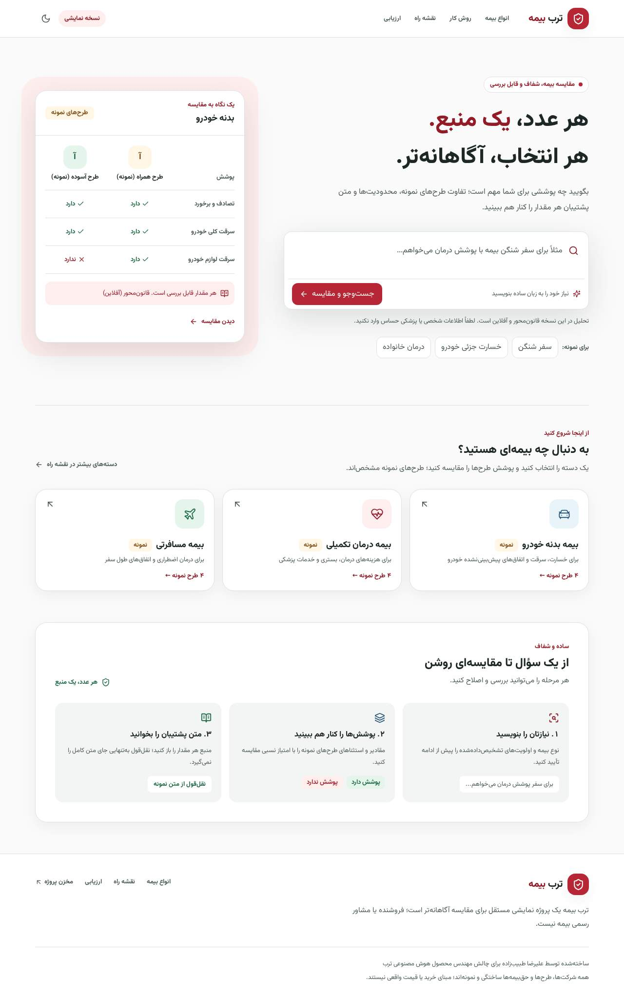

# ترب بیمه

ترب بیمه یک دمو مستقل برای چالش «ترب برای بازاری جدید» است: پوشش‌ها و استثناهای بیمه بدنه خودرو، درمان تکمیلی و مسافرتی را از متن به جدول قابل بررسی می‌رساند. کاربر نیازش را تأیید می‌کند، طرح‌ها را بر اساس پوشش مقایسه می‌کند و برای هر مقدار می‌تواند متن پشتیبان را ببیند. این یک موتور مقایسه است، نه فروشگاه یا مشاور بیمه.

> **دادهٔ ساختگی:** همهٔ شرکت‌ها، ۱۲ طرح، متن بیمه‌نامه‌ها، پوشش‌ها و حق‌بیمه‌های سالانهٔ این دمو نمونه‌اند؛ قیمت واقعی، پیشنهاد خرید، اعتبارسنجی شرکت یا بیمه‌نامهٔ واقعی نیستند. نقل‌قول به‌تنهایی درستی معنایی را ثابت نمی‌کند. اطلاعات شخصی یا پزشکی حساس وارد نکنید.



**دموی زنده:** هنوز مستقر نشده است؛ پس از استقرار، نشانی واقعی را اینجا اضافه کنید. [تصاویر موبایل و دسکتاپ](docs/screenshots/) · [گزارش بررسی و محدودیت‌ها](docs/verification-report.md) · [سناریوی ویدیوی پنج‌دقیقه‌ای](DEMO.md)

## شروع سریع بدون پایگاه داده

Node.js 22 و npm 10 یا جدیدتر لازم‌اند (حداقل Node 20.19). Docker لازم نیست.

```bash
git clone https://github.com/alirezatabi/torob-bime.git
cd torob-bime
npm ci
npm run dev
```

به `http://localhost:3000` بروید. اگر `DATABASE_URL` تنظیم نشده باشد، کاتالوگ نمونه در حافظه و، در نبود اسنپ‌شات معتبر، استخراج **قانون‌محور آفلاین** استفاده می‌شوند؛ این خروجی مدل نیست. نصب استاندارد Prisma ممکن است برای دریافت موتور به اینترنت دسترسی لازم داشته باشد.

### با PostgreSQL محلی یا میزبانی‌شده

یک پایگاه دادهٔ اختصاصی خالی بسازید، `.env.example` را در `.env.local` کپی کنید و `DATABASE_URL` را با اطلاعات خودتان تنظیم کنید. در Windows از `Copy-Item .env.example .env.local` استفاده کنید. رمزها را در Git یا گفتگو قرار ندهید؛ کاراکترهای ویژهٔ نام کاربری و رمز در URL باید encode شوند.

```bash
npm run db:deploy
npm run db:seed
npm run dev
```

`db:seed` داده‌های ساختگی را در پایگاه دادهٔ انتخاب‌شده می‌نویسد. Next، اسکریپت‌ها و CLI پرایزما `.env.local` و `.env` را با `@next/env` می‌خوانند؛ متغیر تنظیم‌شده در محیط فرایند اولویت دارد. در صورت خالی، نامعتبر یا غیرقابل‌دسترسی بودن DB، رابط دلیل بازگشت به نمونه را نشان می‌دهد. [راهنمای کامل Windows و PostgreSQL](docs/setup-windows.md).

## مسیر داده و تصمیم‌ها

```text
متن بیمه‌نامهٔ نمونه ──> استخراج قانون‌محور یا Anthropic ──> نوع، مقدار، واحد و نقل‌قول بررسی‌شده
                                      │                              │
                         اسنپ‌شات معتبر / PostgreSQL            مقدار نامشخص در صورت نبود شاهد
                                      └─────────> جدول و رتبه‌بندی قطعی، منبع و استثناها
نیاز فارسی ──> قواعد یا مدل ──> تأیید و ویرایش کاربر ──> اولویت‌ها، شرط‌ها و URL قابل اشتراک
```

`lib/schemas/` منبع تعریف فیلد، وزن، گروه، واژه‌نامه و واحد است؛ `lib/ai/` استخراج و بررسی شاهد را انجام می‌دهد؛ `lib/domain/` رتبه‌بندی و ورودی را کنترل می‌کند؛ `lib/data/` و `prisma/` داده را ارائه و ذخیره می‌کنند. تنها بخش پشت‌صحنه، متن کامل هر بیمه‌نامهٔ نمونه را دریافت می‌کند؛ صفحهٔ مقایسه فقط برش محدود شاهدها را می‌گیرد.

اولویت انتخابی ۳ برابر وزن دارد؛ ابتدا تعداد شرط‌های تأییدشده، سپس امتیاز نسبی پوشش و در پایان شناسهٔ طرح ترتیب را مشخص می‌کنند. مقدار نامشخص در امتیاز صفر است اما به معنی «پوشش ندارد» نیست. حق‌بیمهٔ **ساختگی سالانه** از متن استخراج و با بودجهٔ سالانه مقایسه می‌شود، اما در امتیاز پوشش دخالت ندارد. بودجهٔ ماهانهٔ صریح به سالانه تبدیل می‌شود؛ مبلغ نامشخص مطابقت فرض نمی‌شود. بودجه، اولویت‌ها و طرح‌های انتخاب‌شده در URL مشترک‌اند، نه متن آزاد جست‌وجو.

## مدل و اسنپ‌شات اختیاری

برای فراخوانی واقعی، `ANTHROPIC_API_KEY` و `LLM_MODEL` را فقط در محیط سرور یا `.env.local` بگذارید؛ `LLM_MODEL_FAST` اختیاری است. با فعال بودن مدل، رابط اعلام می‌کند که متن جست‌وجو برای تحلیل به Anthropic فرستاده می‌شود. همهٔ اجراهای زیر ممکن است هزینهٔ API داشته باشند:

```bash
npm run snapshot              # استخراج ۱۲ طرح؛ اسنپ‌شات‌ها و index را می‌نویسد
npm run snapshot -- --eval    # جداگانه برای ۳۴ سند ارزیابی
npm run eval -- --snapshot    # فقط بازپخش اسنپ‌شات‌های ارزیابی؛ بدون جایگزینی با قواعد
npm run eval -- --live        # استخراج و نیت با مدل؛ هزینهٔ بیشتر
```

پس از تولید اسنپ‌شات کاتالوگ، برای حالت DB `npm run db:seed` را اجرا کنید و برای فایل‌های استاتیک bundled برنامه را دوباره build/restart کنید. منبع، اسکیما، ساختار و شاهد هر اسنپ‌شات هنگام بازپخش بررسی می‌شوند؛ اسنپ‌شات گمشده یا نامعتبر صریحاً به قواعد برمی‌گردد. گزارش آفلاین، بازپخش و زنده جدا هستند. در مخزن فعلی **هیچ اسنپ‌شات مدل واقعی وجود ندارد**؛ مسیر SDK فقط با پاسخ شبیه‌سازی‌شده تست شده است.

برای واردکردن دادهٔ JSON به DB: `npm run ingest -- fixtures/products.json` با مدل فعال، یا `npm run ingest -- fixtures/products.json --offline` فقط برای داده‌هایی که `isSampleData=true` دارند. اجرای نامعتبر، دادهٔ معتبر قبلی را جایگزین نمی‌کند.

## بررسی و استقرار

```bash
npm run typecheck && npm run lint && npm run format:check
npm test && npm run eval && npm run build
npx playwright install chromium
npm run test:e2e
npm run test:e2e:mock-ai
```

دو تست واحد DB فقط با `TEST_DATABASE_URL` فعال می‌شوند؛ آن را صرفاً به یک پایگاه دادهٔ موقت و migrationشده بدهید. تست مرورگرِ شاهدهای هم‌پوشان نیز به همان DB در `DATABASE_URL` و `TEST_DATABASE_URL` نیاز دارد. CI شامل PostgreSQL، build و Playwright است. آخرین ارزیابی قواعد روی دادهٔ مصنوعی: **۱۲۹/۱۳۲ مقدار**، **۹۴/۹۴ نقل‌قول خام غیرخالی** و **۲۸/۳۰ نوع نیت**؛ این سنجه‌ها ارزیابی مستقل یا عملکرد مدل نیستند. جزئیات و خطاها در [گزارش ارزیابی](docs/EVAL_REPORT.md) و `/evaluation` است. قبل از build، اجرای `npm run eval` فایل‌های استاتیک گزارش را به‌روزرسانی می‌کند؛ request handler فایل را در زمان اجرا نمی‌خواند.

[راهنمای استقرار Vercel + PostgreSQL](docs/deployment.md) مراحل و تست‌های دستی را توضیح می‌دهد؛ استقرار، نصب تمیز شبکه‌دار، Windows بومی و Anthropic زنده در این محیط تأیید نشده‌اند. محدودکنندهٔ نرخ و cache فرایندی‌اند و برای استقرار چندنمونه‌ای باید با سرویس توزیع‌شده و تنظیم امن proxy جایگزین شوند.

ساخته‌شده توسط علیرضا طبیب‌زاده برای چالش مهندس محصول هوش مصنوعی ترب؛ پروژه مستقل است و وابستگی سازمانی به ترب ندارد.
